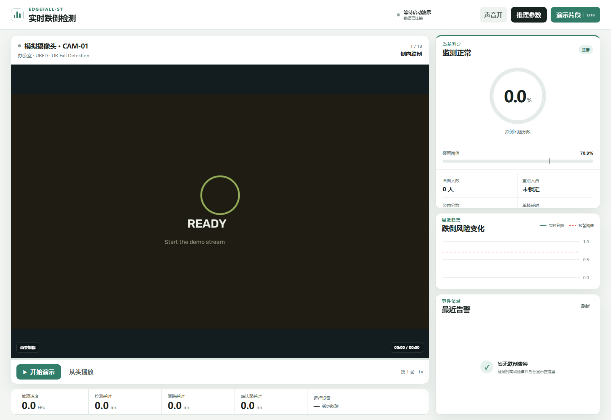
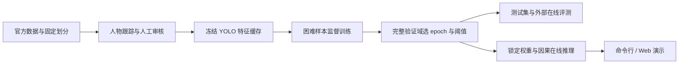

<div align="center">

# EdgeFall

**让普通摄像头理解跌倒发生的过程。**

面向边缘部署的因果视频跌倒检测研究与演示项目

[English](README.en.md) · [方法设计](docs/method.md) · [训练复现](docs/training.md) · [测试结果](docs/benchmarks.md) · [部署演示](docs/deployment.md) · [项目展示](docs/showcase.md)


</div>

EdgeFall 从人物的运动轨迹、身体附近的视觉细节和全局场景中共同寻找跌倒证据。
它复用一次 YOLO26s 前向计算获得的空间特征，以轻量时序确认器识别跌倒转移与持续倒地，
提供逐人物分数、报警时刻和可追溯结果。项目包含训练、评测、命令行推理与 Vue + FastAPI 演示。

当前发布候选锁定 **HN3-B-R Seed-1 Epoch 8**。这份技术作品集将方法动机、训练流程、
可追溯实验与在线系统放在同一个项目中，展示从建模到工程验证的完整过程。

## 为什么需要时间、几何和场景一起判断

坐下、弯腰、躺到床上与跌倒可以具有相似的单帧外观。EdgeFall 用三个互补线索做确认：

- **运动几何**：人物框的位置、比例和变化，描述身体如何移动。
- **人物 ROI**：复用 P3/P4 特征，观察人物与附近支撑物的关系。
- **全局场景**：复用 P4/P5 特征，为床、椅子、地面等上下文提供视觉证据。

几何状态作为 Query，从全局与 ROI 视觉状态中提取相关证据。短、长时间分支覆盖当前到
3.2 秒历史，全过程只读取当前和过去。P3/P4/P5 是空间尺度；稀疏历史采样是时间尺度。
模型不使用人体骨架、深度或音频。[结构、张量维度与采样说明 →](docs/method.md)

## 这份项目体现的技术工作

| 工作 | 具体实现 | 可检查的证据 |
|---|---|---|
| 轻量时空建模 | 共享空间特征、双时间尺度、几何条件注意力 | [核心模型](edgefall_st/models/fygr.py)、[几何编码器](edgefall_st/models/bbox_classifier.py) |
| 数据与训练工程 | 人物跟踪、人工审核、冻结缓存、困难样本采样 | [训练指南](docs/training.md)、[审核标注](annotations/omnifall/)、[训练参数](reports/training_parameters.yaml) |
| 严谨评测 | 完整验证域选模、验证阈值锁定、跨域和外部评测 | [原始结果](reports/evidence/)、[评测实现](edgefall_st/evaluation/) |
| 在线系统 | 人物历史状态、逐帧输出、Vue/FastAPI、live/replay | [推理入口](infer.py)、[Web App](Application/)、[部署指南](docs/deployment.md) |

## 已有实验结果

| 证据 | 结果 | 测量范围 |
|---|---:|---|
| 总参数量 | **12,212,714** | YOLO26s + 含几何分支的确认器 |
| 三域宏 AP | **0.9226** | 冻结特征缓存上的视频级测试 |
| 三域宏 Mean-P | **0.8262** | `(P90 + P95) / 2`；按数据域等权平均 |
| 锁定阈值下 pooled Recall | **0.9379** | 三域 7,661 个测试视频，阈值来自验证集 |
| UR Fall 跌倒检出 | **30 / 30** | 70 段独立在线评测；同时有 19 / 40 ADL 误报 |
| UR Fall 平均算法时延 | **44.34 ms** | RTX 4070 Ti SUPER，单人物协议，不含解码 |

三域按数据集分别为：

| 测试域 | 视频数 | AP | P90 | P95 | Mean-P |
|---|---:|---:|---:|---:|---:|
| OmniFall OF-Syn | 2,400 | 0.8355 | 0.6837 | 0.6083 | 0.6460 |
| Fall Video Dataset | 5,241 | 0.9414 | 0.9015 | 0.8548 | 0.8782 |
| CAUCAFall | 20 | 0.9909 | 1.0000 | 0.9091 | 0.9545 |
| 宏平均 | — | **0.9226** | **0.8617** | **0.7907** | **0.8262** |

这些是项目已有实验记录，尚无独立第三方复测。CAUCAFall 测试样本少，UR Fall 正常活动
误报仍较多，不能把短片演示准确率视为产品精度。默认推理最多 2 人，历史 UR 时延是
`max_people=1` 协议。完整定义、缺失窗口处理、阈值与原始 JSON 见[评测说明](docs/benchmarks.md)。

## 快速运行

推荐 Python 3.11。先按显卡安装合适的 PyTorch / TorchVision，再安装项目：

```bash
git clone https://github.com/Hongtauo/EdgeFall.git
cd EdgeFall
conda create -n EdgeFall-ST python=3.11 -y
conda activate EdgeFall-ST
python -m pip install -e ".[inference,demo,dev]"
```

源码仓库与第三方视频、模型资产分开管理。本地整理目录已放入现有提交包的模型和演示素材，
Git 默认忽略这些二进制文件。全新 clone 后需按[模型资产说明](models/README.md)恢复三个权重，
自备视频即可推理；仓库尚未发布可下载的模型 Release。

```bash
python tools/verify_install.py --device auto
python infer.py --input /path/to/video.mp4 --device auto
```

输出在 `results/<时间戳>/`：`predictions.csv` 为视频分数与报警结果，`frames.csv` 为
逐采样时刻、逐人物结果，`summary.json` 为参数、权重哈希及测量摘要。
默认报警阈值为验证集锁定的 **0.7094**。

V100 应使用包含 `sm_70` 的 CUDA 11.8 依赖：

```bash
python -m pip install -r setup/requirements-v100-cu118.txt
python -m pip install -e ".[inference,demo,dev]" --no-deps
python -m pip install -r Application/backend/requirements-live.txt
```

V100 代码兼容性已审计，未完成 V100 实机验收。[完整环境与部署说明 →](docs/deployment.md)

## 在线演示

演示提供视频画面、人物框、风险曲线、事件列表及实时遥测。
两种模式在界面中明确区分：`live` 实际执行模型，`replay` 读取保存的预测结果。
现有本地素材包含 18 段播放列表；素材取得和再分发范围见[数据集说明](docs/datasets.md)。



*真实本机界面的待启动状态截图，展示视频、风险曲线、人物状态与事件面板；此图不含模型预测结果或第三方视频画面。*

```bash
cd Application/frontend
npm ci
npm run build
cd ../backend
# Linux / macOS
EDGEFALL_ENGINE=live python -m uvicorn app.main:app --host 127.0.0.1 --port 8000
```

Windows PowerShell：

```powershell
cd Application
.\start_demo.ps1 -Mode live -PythonPath (Get-Command python).Source
```

浏览器访问 `http://127.0.0.1:8000`。演示启动需要先按资产说明恢复播放列表视频。
`live` 加载失败会报错；只有显式选择 `auto` 时才可能回退到带标识的回放。

## 从训练到部署



训练配置包含三域数据、4,459 个困难负候选、327 个困难正视频与主人物人工修订。
训练缓存仅用于加速训练，在线推理直接处理视频。
`scripts/train_hn3br.py --dry-run` 可检查公开配置对应的命令；执行训练前需准备原始数据、
特征缓存和审核 overlay。不能仅凭推理权重重建完整训练数据。

```bash
python scripts/train_hn3br.py --dry-run
python -m pytest -q
```

## 项目导航

| 内容 | 文档 / 入口 |
|---|---|
| 模型设计与空间 / 时间尺度 | [docs/method.md](docs/method.md) |
| 训练、特征与监督组织 | [docs/training.md](docs/training.md) |
| 数据来源、划分与获取 | [docs/datasets.md](docs/datasets.md) |
| 指标定义、完整结果与证据 | [docs/benchmarks.md](docs/benchmarks.md) / [reports/](reports/) |
| 环境、推理、App 与导出路线 | [docs/deployment.md](docs/deployment.md) |
| Python 接入与评测接口 | [docs/api_zh.md](docs/api_zh.md) |
| 3–5 分钟技术作品讲解 | [docs/showcase.md](docs/showcase.md) |
| 研究与工程验证路线 | [docs/roadmap.md](docs/roadmap.md) |
| 发布流程与资产管理 | [docs/release.md](docs/release.md) |
| 第三方许可与来源 | [docs/third_party.md](docs/third_party.md) |

## 参与与联系

欢迎复现、提交错误案例和贡献部署后端。问题与合作沟通可通过
[GitHub Issues](https://github.com/Hongtauo/EdgeFall/issues) 发起。
贡献方式见 [CONTRIBUTING.md](CONTRIBUTING.md)。

项目的下一步是长时误报评估、跨设备性能回归和端侧导出验证。
源码许可证尚待项目所有者确认，当前整理结果为发布候选；见[发布说明](docs/release.md)。
