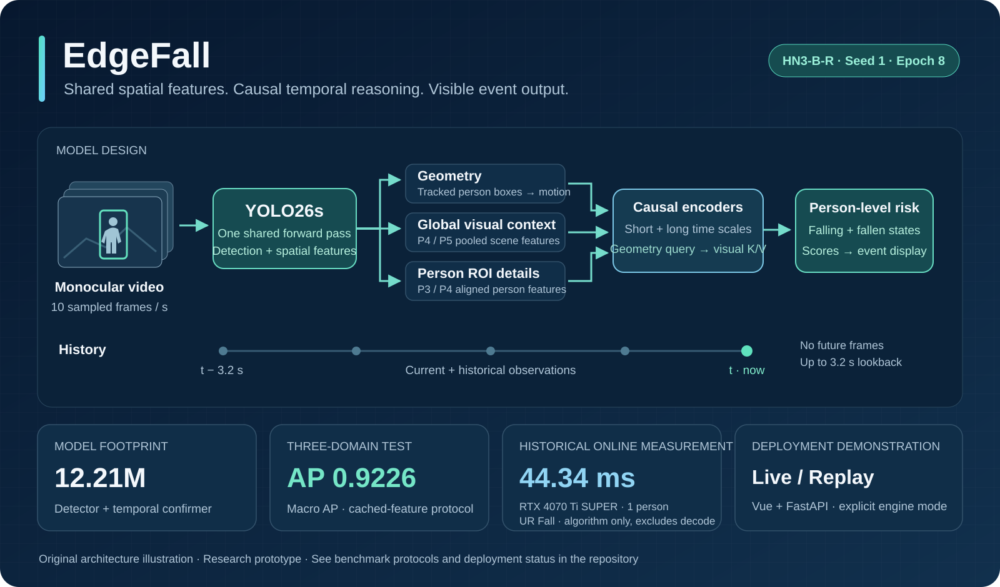
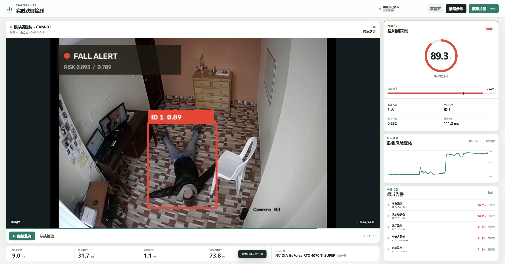
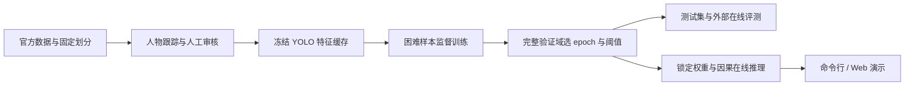

<div align="center">

# EdgeFall

基于几何轨迹与共享视觉特征的视频跌倒检测

[English](README.en.md) · [方法](docs/method.md) · [训练](docs/training.md) · [评测](docs/benchmarks.md) · [部署](docs/deployment.md) · [演示](docs/showcase.md)


[](LICENSE)



</div>

EdgeFall 使用单目视频中的人物框轨迹、人物局部特征和场景特征检测跌倒。
YOLO26s 同时完成人体检测和视觉特征提取，时序确认器结合历史观测，
输出逐人物跌倒分数和报警时刻。仓库包含数据处理、训练、评测、在线推理和 Web 演示代码。

当前模型为 **HN3-B-R Seed-1 Epoch 8**，总参数量 12.21M，按 10 FPS 采样，最多使用 3.2 秒历史。

## 方法概述

坐下、弯腰、躺到床上与跌倒可能具有相似的单帧外观。模型因此同时使用三类信息：

- **运动几何**：人物框的位置、比例和变化，描述身体如何移动。
- **人物 ROI**：复用 P3/P4 特征，观察人物与附近支撑物的关系。
- **全局场景**：复用 P4/P5 特征，为床、椅子、地面等上下文提供视觉证据。

几何状态作为 Query，对全局与 ROI 视觉状态做交叉注意力。短、长时间分支覆盖当前到
3.2 秒历史，全过程只读取当前和过去。P3/P4/P5 是空间尺度；稀疏历史采样是时间尺度。
模型不使用人体骨架、深度或音频。[结构、张量维度与采样说明 →](docs/method.md)

## 实验结果

| 项目 | 结果 | 测量范围 |
|---|---:|---|
| 总参数量 | **12,212,714** | YOLO26s + 含几何分支的确认器 |
| 三域宏 AP | **0.9226** | 冻结特征缓存上的视频级测试 |
| 三域宏 Mean-P | **0.8262** | `(P90 + P95) / 2`；按数据域等权平均 |
| 锁定阈值下 pooled Recall | **0.9379** | 三域 7,661 个测试视频，阈值来自验证集 |
| UR Fall 跌倒检出 | **30 / 30** | 70 段独立在线评测；同时有 19 / 40 ADL 误报 |
| UR Fall 平均算法时延 | **44.34 ms** | RTX 4070 Ti SUPER，单人物协议，不含解码 |

三域按数据集分别为：

| 测试域 | 视频数 | AP | P90 | P95 | Mean-P |
|---|---:|---:|---:|---:|---:|
| OmniFall OF-Syn | 2,400 | 0.8355 | 0.6837 | 0.6083 | 0.6460 |
| Fall Video Dataset | 5,241 | 0.9414 | 0.9015 | 0.8548 | 0.8782 |
| CAUCAFall | 20 | 0.9909 | 1.0000 | 0.9091 | 0.9545 |
| 宏平均 | — | **0.9226** | **0.8617** | **0.7907** | **0.8262** |

三域结果使用缓存特征评测。UR Fall 单独运行完整在线链路，在 30 个跌倒视频中全部检出，
40 个正常活动视频中有 19 个误报。CAUCAFall 测试集只有 20 段视频。
默认推理最多处理 2 人，UR Fall 时延按 `max_people=1` 测量。
指标定义、实验设置和原始记录见[评测说明](docs/benchmarks.md)。

## 快速运行

推荐 Python 3.11。先按显卡安装合适的 PyTorch / TorchVision，再安装项目：

```bash
git clone https://github.com/Hongtauo/EdgeFall.git
cd EdgeFall
conda create -n EdgeFall-ST python=3.11 -y
conda activate EdgeFall-ST
python -m pip install -e ".[inference,demo,dev]"
```

仓库不包含模型权重和数据集视频。推理前需按[模型说明](models/README.md)将三个权重放入
`models/`，再指定自己的视频。目前尚未提供模型权重下载。

```bash
python tools/verify_install.py --device auto
python infer.py --input /path/to/video.mp4 --device auto
```

输出在 `results/<时间戳>/`：`predictions.csv` 为视频分数与报警结果，`frames.csv` 为
逐采样时刻、逐人物结果，`summary.json` 为参数、权重哈希及测量摘要。
默认报警阈值为验证集锁定的 **0.7094**。

V100 需要包含 `sm_70` 的 PyTorch 构建，安装命令见[部署说明](docs/deployment.md)。

## 在线演示

Web App 使用 Vue 和 FastAPI，显示视频、人物框、分数曲线、报警事件和运行时延。
`live` 模式执行模型推理，`replay` 模式读取保存的逐帧结果。
默认播放列表包含 18 段视频，需另外准备对应素材，见[演示说明](docs/showcase.md)。



*CAUCAFall 向后跌倒片段的运行截图。视频来源与署名见[素材说明](docs/third_party.md#演示截图)。*

```bash
cd Application/frontend
npm ci
npm run build
cd ../backend
# Linux / macOS
EDGEFALL_ENGINE=live python -m uvicorn app.main:app --host 127.0.0.1 --port 8000
```

Windows PowerShell：

```powershell
cd Application
.\start_demo.ps1 -Mode live -PythonPath (Get-Command python).Source
```

浏览器访问 `http://127.0.0.1:8000`。演示启动需要先按资产说明恢复播放列表视频。
`live` 加载失败会报错；只有显式选择 `auto` 时才可能回退到带标识的回放。

## 训练流程



训练使用三个数据域、4,459 个困难负候选、327 个困难正视频，以及人工修订的主人物标注。
YOLO 与几何分支冻结，训练阶段读取预提取的视觉特征；在线推理直接处理视频。
数据准备和训练命令见[训练指南](docs/training.md)。

```bash
python scripts/train_hn3br.py --dry-run
python -m pytest -q
```

## 项目导航

| 内容 | 文档 / 入口 |
|---|---|
| 模型设计与空间 / 时间尺度 | [docs/method.md](docs/method.md) |
| 训练、特征与监督组织 | [docs/training.md](docs/training.md) |
| 数据来源、划分与获取 | [docs/datasets.md](docs/datasets.md) |
| 指标定义、完整结果与证据 | [docs/benchmarks.md](docs/benchmarks.md) / [reports/](reports/) |
| 环境、推理、App 与导出路线 | [docs/deployment.md](docs/deployment.md) |
| Python 接入与评测接口 | [docs/api_zh.md](docs/api_zh.md) |
| Web App 与演示样本 | [docs/showcase.md](docs/showcase.md) |
| 后续工作 | [docs/roadmap.md](docs/roadmap.md) |
| 发布流程与资产管理 | [docs/release.md](docs/release.md) |
| 第三方许可与来源 | [docs/third_party.md](docs/third_party.md) |

## 参与与联系

运行问题、错误案例和改进建议可提交到
[GitHub Issues](https://github.com/Hongtauo/EdgeFall/issues)。
贡献方式见 [CONTRIBUTING.md](CONTRIBUTING.md)。

源码采用 [GNU AGPL-3.0](LICENSE)。第三方依赖、数据集、视频和模型权重保留各自的许可，见 [NOTICE](NOTICE) 和[第三方说明](docs/third_party.md)。
